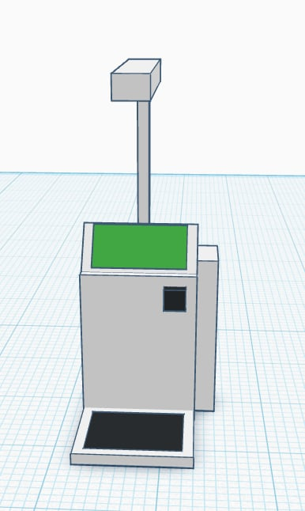

<div align="center">


<br/>

**A smarter way to organize basic health measurements.**

*PD1 Prototype Project · Healthcare Technology*

<br/>


</div>

---

<div align="center">

### ୨୧ ABOUT THE PROJECT ୨୧

</div>

**KioskPro – Health Kiosk System** is a proposed digital kiosk that helps users record basic vital signs and view their measurements through a simple, organized interface.

Designed as a PD1 prototype concept, it explores how computer technology can support basic health monitoring in schools, clinics, and community environments.

The goal is to make recorded measurements easier to access and understand without replacing professional medical assessment.

---

<div align="center">

### ♡ WHAT MAKES IT SPECIAL?

</div>

<table>
<tr>
<td align="center" width="50%">

### 🌡️

**Temperature**

<br/>

Record body temperature using a suitable measurement device.

</td>
<td align="center" width="50%">

### 💗

**Pulse Rate**

<br/>

Record pulse readings in beats per minute (BPM).

</td>
</tr>
<tr>
<td align="center" width="50%">

### 🩺

**Blood Pressure**

<br/>

Record systolic and diastolic readings from a compatible monitor.

</td>
<td align="center" width="50%">

### 📈

**Results Overview**

<br/>

Present readings with clear labels, units, and timestamps.

</td>
</tr>
<tr>
<td align="center" width="50%">

### 🗂️

**Measurement History**

<br/>

Review previous readings when storage is implemented.

</td>
<td align="center" width="50%">

### 📋

**Health Summary**

<br/>

Organize recorded measurements for personal reference.

</td>
</tr>
</table>

---

<div align="center">

### ୨୧ DESIGN PREVIEW ୨୧

</div>

<div align="center">

<!-- Replace this with your actual project screenshot -->




</div>

The proposed design focuses on clear information, readable text, and simple navigation for computer, tablet, or touchscreen use.

---

<div align="center">

### ♡ SYSTEM ARCHITECTURE

</div>

```text
        ┌──────────────────────┐
        │      KIOSK USER      │
        └──────────┬───────────┘
                   │
                   ▼
        ┌──────────────────────┐
        │   KIOSK INTERFACE    │
        └──────────┬───────────┘
                   │
                   ▼
        ┌──────────────────────┐
        │ MEASUREMENT DEVICES  │
        │ Temperature / BP /   │
        │ Pulse (as available) │
        └──────────┬───────────┘
                   │
                   ▼
        ┌──────────────────────┐
        │ RECORD & DISPLAY     │
        │     MEASUREMENTS     │
        └──────────┬───────────┘
                   │
                   ▼
        ┌──────────────────────┐
        │ OPTIONAL DATA STORAGE│
        └──────────────────────┘
```


---

<div align="center">

### ୨୧ TECHNOLOGY & COMPONENTS ୨୧

</div>

| Component | Function |
|---|---|
| Computer / Mini PC | Runs the kiosk application |
| Display / Touchscreen | Shows the kiosk interface |
| Temperature Device | Records body temperature |
| Blood Pressure Monitor | Measures blood pressure |
| Pulse Measurement Device | Records pulse rate |
| Local Storage / Database | Stores readings if implemented |
| Kiosk Stand | Supports the equipment |

**Proposed software areas**


The final programming language, framework, and database will depend on the technologies selected for the prototype.

---

<div align="center">

### ♡ USER JOURNEY

</div>

<table>
<tr>
<td align="center">**01**<br/>Start</td>
<td align="center">**02**<br/>Select</td>
<td align="center">**03**<br/>Measure</td>
<td align="center">**04**<br/>Record</td>
<td align="center">**05**<br/>Review</td>
</tr>
</table>

1. Open the kiosk interface.
2. Select an available measurement.
3. Obtain a reading from a suitable device or enter an existing reading if supported.
4. Display and optionally save the result.
5. Review the available measurements and finish the session.

---

<div align="center">

### ୨୧ WHO IS IT FOR? ୨୧

</div>

- Students and school personnel
- Clinic visitors
- Community members
- Individuals recording basic vital signs
- Healthcare staff assisting with routine measurements

---

<div align="center">

### ♡ FUTURE PLANS

</div>

- [ ] Touchscreen interface
- [ ] Automatic sensor integration
- [ ] Digital blood pressure monitor integration
- [ ] Temperature and pulse device integration
- [ ] Measurement history
- [ ] Printable measurement summary
- [ ] Optional user profiles
- [ ] Local database
- [ ] Secure data management
- [ ] Accessibility improvements

---

<div align="center">

### ୨୧ PRIVACY & SAFETY ୨୧

</div>

Health measurements are sensitive personal information. Any implemented storage should protect records with appropriate access controls and prevent one user's private information from being shown to another.

> **Disclaimer:** KioskPro is an educational prototype concept, not a medical diagnostic system. Measurement accuracy depends on the device and procedure used. Results do not replace advice or assessment from a qualified healthcare professional.

---

<div align="center">


**KioskPro – Health Kiosk System**

<sub>PD1 Prototype Project · Healthcare Technology · Concept Development</sub>

</div>
